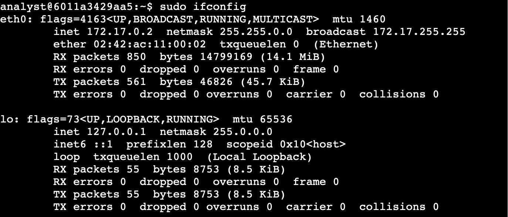
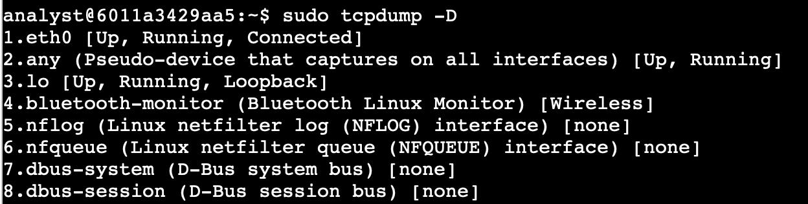
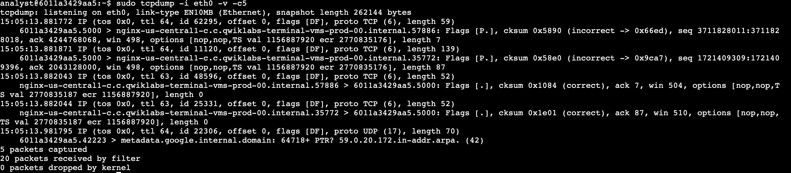
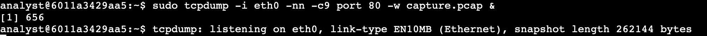
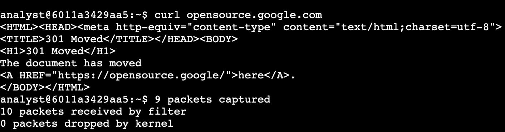
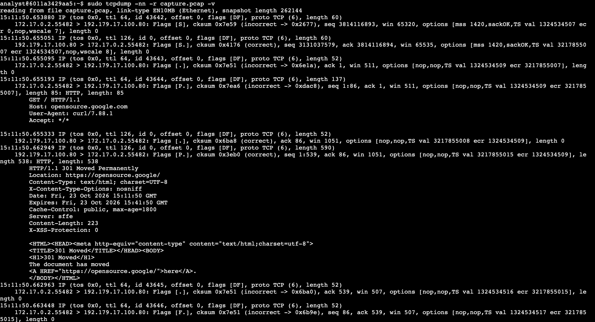
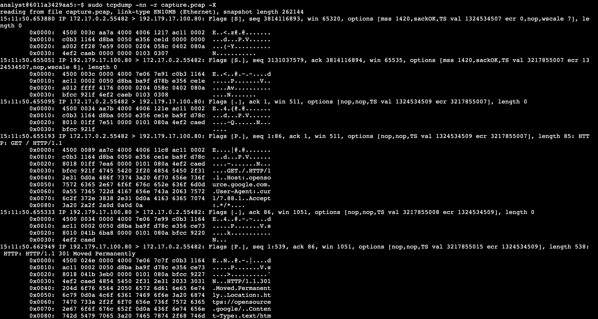

# tcpdump Lab: Capturing and Analyzing Network Traffic

## Overview

As a network analyst, I used `tcpdump` on a Linux virtual machine to capture live network traffic, save it to a packet capture (pcap) file, and then filter the saved data to look at specific types of traffic. Capturing and filtering traffic from the command line is a core skill for a security analyst.

**Tools:** tcpdump, Linux command line, curl

**Skills demonstrated:** identifying network interfaces, capturing live traffic, filtering by port, saving and reading pcap files

## Task 1: Identify network interfaces

First I needed to know which interface to capture from. `ifconfig` lists the interfaces on the machine:

```bash
sudo ifconfig
```



The Ethernet interface is the one with the `eth` prefix, so I used **eth0** (IP address 172.17.0.2) for the rest of the lab. The other interface, `lo`, is the loopback interface.

`tcpdump` can list the available interfaces as well, which is useful on systems that don't have `ifconfig`:

```bash
sudo tcpdump -D
```



## Task 2: Inspect live traffic

I captured and displayed five packets from eth0:

```bash
sudo tcpdump -i eth0 -v -c5
```



| Option | Meaning |
|---|---|
| `-i eth0` | Capture from the eth0 interface |
| `-v` | Show detailed (verbose) packet information |
| `-c5` | Stop after capturing 5 packets |

## Task 3: Capture traffic to a file

Next I captured only web traffic and saved it to a file:

```bash
sudo tcpdump -i eth0 -nn -c9 port 80 -w capture.pcap &
```



| Option | Meaning |
|---|---|
| `-i eth0` | Capture from the eth0 interface |
| `-nn` | Don't resolve IP addresses or ports to names. This is a security best practice because the lookup data may not be valid, and the lookups could alert a malicious actor that they are being investigated |
| `-c9` | Capture 9 packets and then exit |
| `port 80` | Only capture traffic on port 80, the default HTTP port |
| `-w capture.pcap` | Save the packets to a file named `capture.pcap` |
| `&` | Run the command in the background so I can keep using the terminal |

While `tcpdump` was listening, I generated some HTTP traffic with `curl`:

```bash
curl opensource.google.com
```



The server replied with a "301 Moved" page, and tcpdump reported 9 packets captured and 0 dropped by the kernel.

## Task 4: Filter the captured packet data

I read the saved capture back from the file. The first command shows the packet headers in detail:

```bash
sudo tcpdump -nn -r capture.pcap -v
```



| Option | Meaning |
|---|---|
| `-nn` | Don't resolve names |
| `-r capture.pcap` | Read packets from the saved file |
| `-v` | Show detailed packet information |

The second command also shows the packet contents in hexadecimal and ASCII:

```bash
sudo tcpdump -nn -r capture.pcap -X
```



Analysts use the hex and ASCII view to spot patterns or anomalies, for example during malware analysis or forensic analysis.

## Findings

- The capture shows the full web request: the TCP handshake, an HTTP `GET / HTTP/1.1` request to the host `opensource.google.com` (user agent `curl`), and an `HTTP/1.1 301 Moved Permanently` response pointing to `https://opensource.google/`.
- Because the traffic was HTTP on port 80 and not encrypted, the request and response could be read in plain text in the `-X` output. This is a good illustration of why unencrypted traffic is a risk.

## What I learned

- How to find the right interface to capture from
- How to capture only the traffic I need with a port filter and a packet count
- How to save traffic to a pcap file and analyze it later, with or without hex and ASCII output
- Why `-nn` is the safer choice during an investigation
