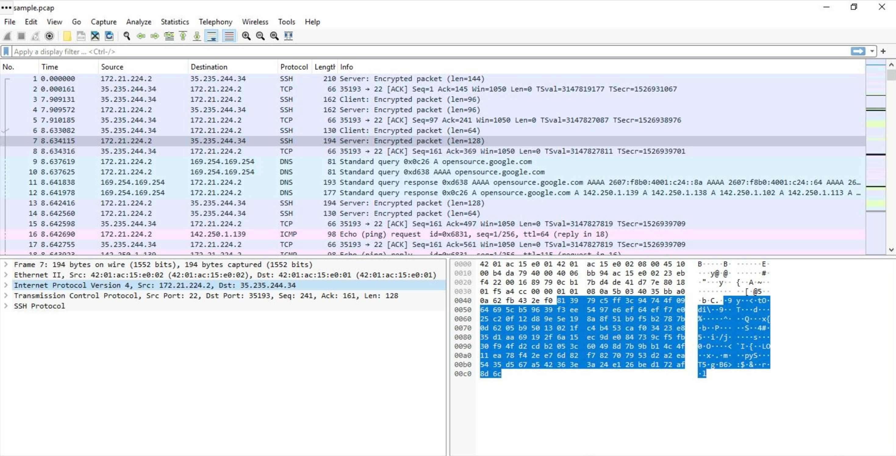
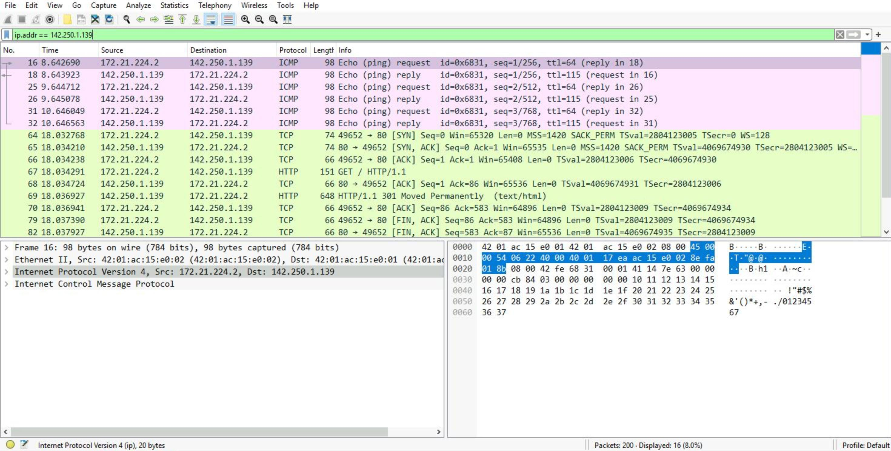
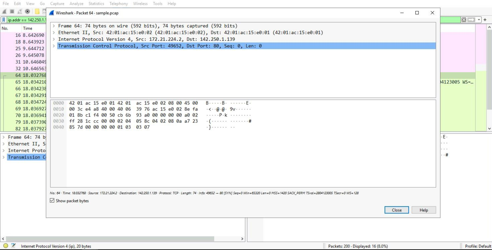
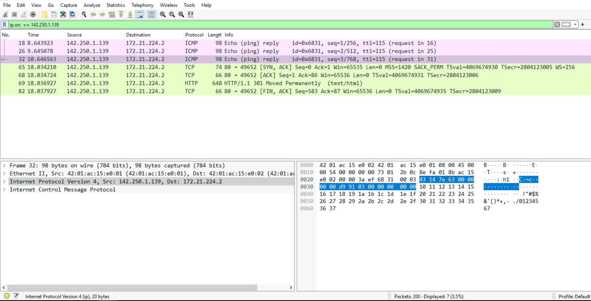
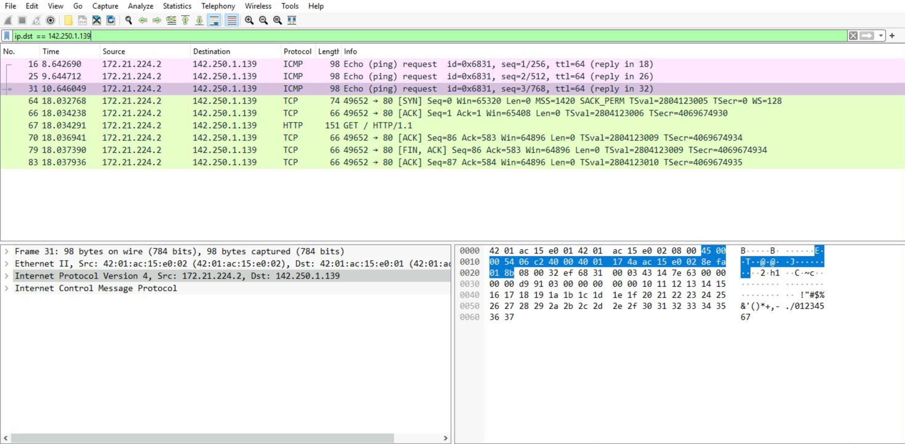
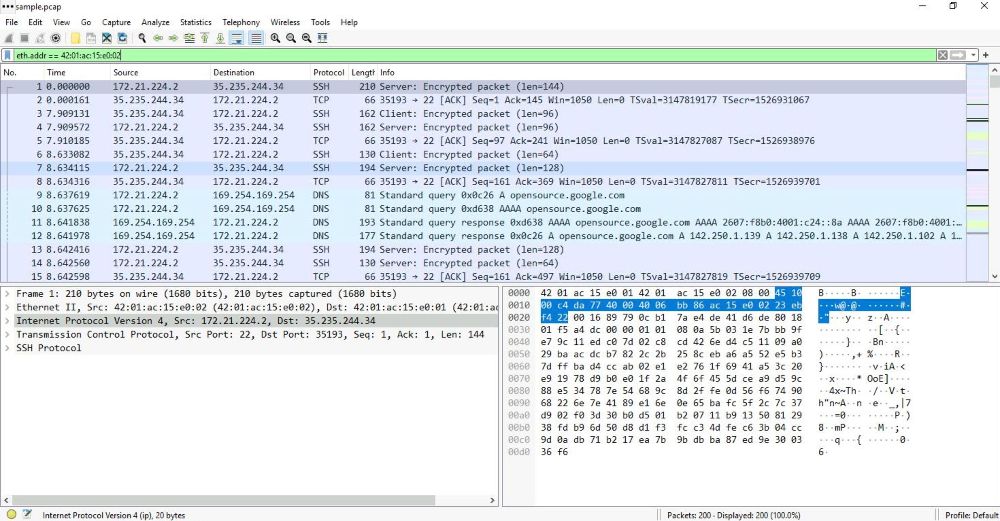
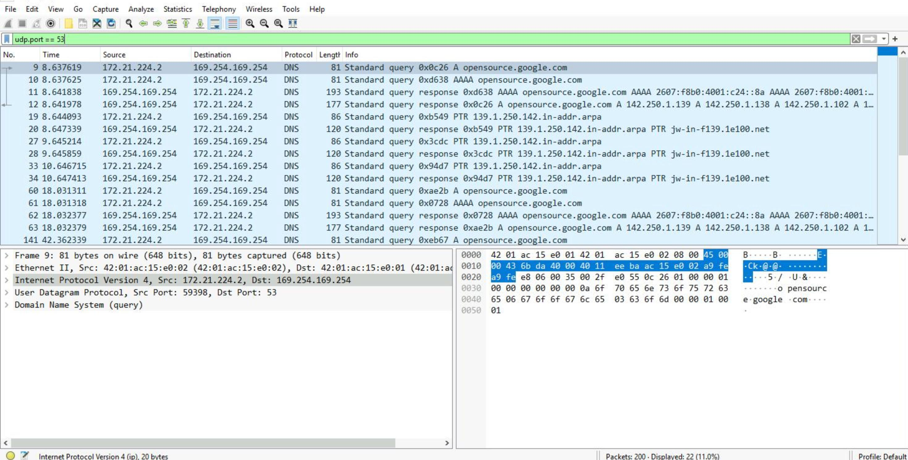
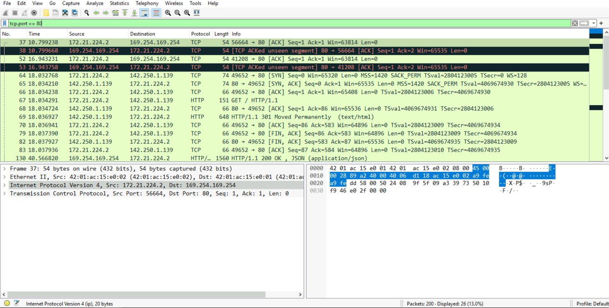

# Wireshark Lab: Analyzing a Packet Capture

## Overview

As a security analyst investigating traffic to a website, I analyzed a packet capture file of a user connecting to an internet site. The goal was to filter the data to:

- identify the source and destination IP addresses in the web browsing session
- examine the protocols used when the user connects to the website
- analyze some of the packets to see what kind of information the systems sent and received

**Tools:** Wireshark

**Skills demonstrated:** reading packet captures, building display filters, inspecting packet layers, analyzing DNS, TCP, and HTTP traffic

## Task 1: Explore the data in Wireshark

I opened the capture file (`sample.pcap`, 200 packets) in Wireshark to see how the data is presented.



Each packet appears as a row with these columns:

| Column | Meaning |
|---|---|
| No. | The packet's index number in the capture file |
| Time | The timestamp of the packet |
| Source | The source IP address |
| Destination | The destination IP address |
| Protocol | The protocol contained in the packet |
| Length | The total length of the packet |
| Info | Information about the packet's data, as interpreted by Wireshark |

## Task 2: Apply a basic filter and inspect a packet

I filtered for all packets to or from one IP address:

```
ip.addr == 142.250.1.139
```

This showed 16 of the 200 packets (8.0%): ICMP echo (ping) requests and replies, and the TCP and HTTP traffic of a web request.



Then I opened one packet in its own window to look at its layers. The upper section shows the packet as a tree of layers (subtrees), and the lower section shows the raw data in hexadecimal and ASCII. A dot (`.`) in the ASCII view is a placeholder for bytes that aren't printable characters.



| Layer | What it shows |
|---|---|
| Frame | Overall packet details such as frame length and arrival time |
| Ethernet II | Source and destination MAC addresses and the type of protocol inside |
| Internet Protocol Version 4 | Source and destination IP addresses and the protocol carried inside (for example TCP or UDP) |
| Transmission Control Protocol | Source and destination ports, sequence numbers, and TCP flags |

## Task 3: Filter by source, destination, and MAC address

**Source IP:** only packets sent *from* 142.250.1.139 (7 packets, 3.5%):

```
ip.src == 142.250.1.139
```



**Destination IP:** only packets sent *to* 142.250.1.139 (9 packets):

```
ip.dst == 142.250.1.139
```



**MAC address:** all traffic involving one hardware address, whatever the protocol:

```
eth.addr == 42:01:ac:15:e0:02
```



Filters like these help a security analyst find the traffic tied to a specific address, such as one suspected of an attack, instead of searching through thousands of packets by hand.

## Task 4: Explore DNS packets

DNS translates names into IP addresses. I used this filter to show only DNS queries and responses (UDP port 53):

```
udp.port == 53
```

22 packets matched (11.0%). The queries ask for the name `opensource.google.com`, and the responses return the IP addresses (for example 142.250.1.139, 142.250.1.138, and 142.250.1.102).



## Task 5: Explore TCP packets

I filtered for traffic on port 80, the default port for HTTP:

```
tcp.port == 80
```

26 packets matched (13.0%).



## Findings

- **Hosts:** the user's machine at `172.21.224.2` communicated with the external server `142.250.1.139`.
- **Protocols:** DNS (name lookup), ICMP (ping), TCP (the connection), and HTTP (the web request). The user made a `GET / HTTP/1.1` request and received an `HTTP/1.1 301 Moved Permanently` response.
- **MAC address:** the local host's interface uses `42:01:ac:15:e0:02`.

## What I learned

- How to read Wireshark's packet list and the layers of an individual packet
- How to use display filters to narrow thousands of packets down to the ones that matter
- How DNS, TCP, ICMP, and HTTP traffic looks in a capture
