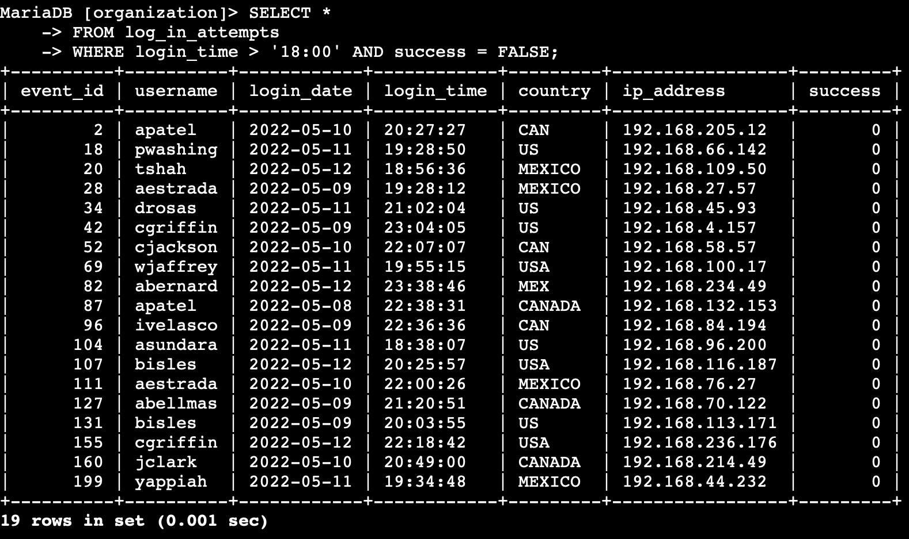
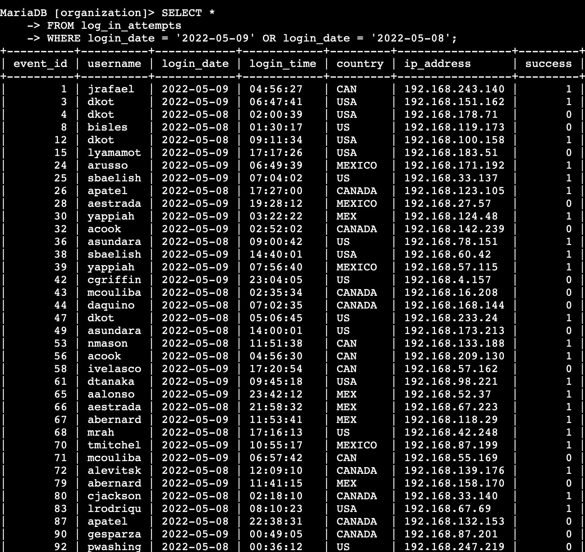
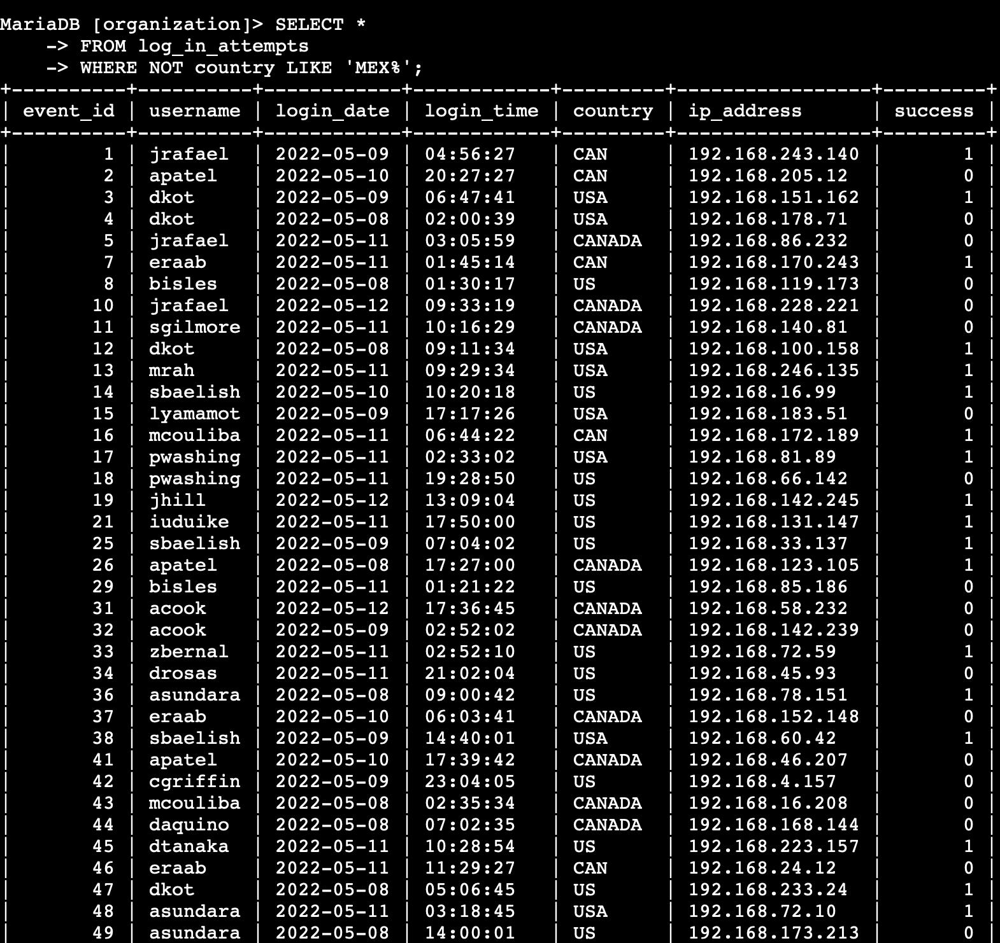
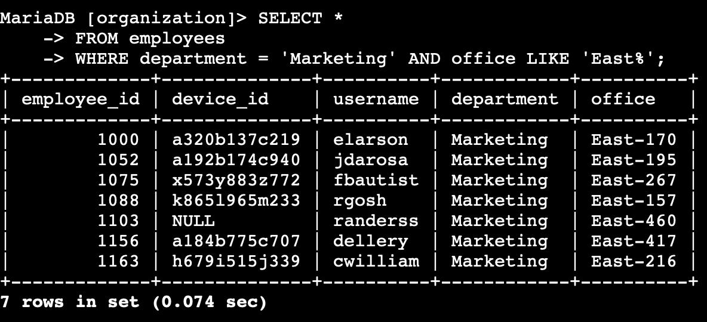
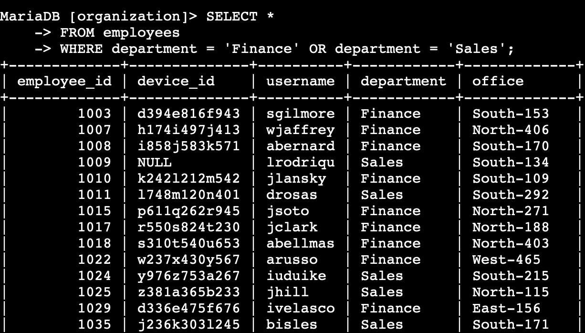
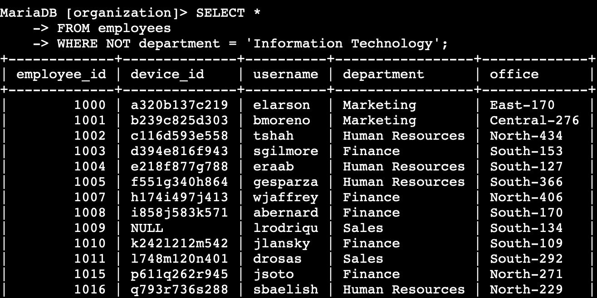

# Apply Filters to SQL Queries

## Overview

As a security analyst at a large organization, I investigated potential security issues involving login attempts and employee machines. I used SQL filters to pull specific records from two tables, `log_in_attempts` and `employees`, in a MariaDB database named `organization`.

**Tools:** SQL (MariaDB), Linux command line

**Skills demonstrated:** `SELECT`, `FROM`, `WHERE`, the `AND`, `OR`, and `NOT` operators, and pattern matching with `LIKE` and the `%` wildcard

## Part 1: Investigating login attempts

### Failed login attempts after business hours

The team was investigating failed logins made after business hours, so I looked for unsuccessful attempts after 18:00.

```sql
SELECT *
FROM log_in_attempts
WHERE login_time > '18:00' AND success = FALSE;
```



- `SELECT *` returns every column.
- `FROM log_in_attempts` names the table.
- `WHERE login_time > '18:00' AND success = FALSE` keeps only the rows that match both conditions: the attempt was after 18:00 and it failed.

**Result:** 19 rows. Several users, such as `apatel`, `bisles`, `aestrada`, and `cgriffin`, appear more than once.

### Login attempts on specific dates

The team was investigating a suspicious event on 2022-05-09, so I needed all login attempts from that day and the day before.

```sql
SELECT *
FROM log_in_attempts
WHERE login_date = '2022-05-09' OR login_date = '2022-05-08';
```



`OR` returns a row if either condition is true, so the query returns attempts from both dates and nothing else.

### Login attempts outside of Mexico

Next, the team wanted logins that did not come from Mexico.

```sql
SELECT *
FROM log_in_attempts
WHERE NOT country LIKE 'MEX%';
```



The country column uses both `MEX` and `MEXICO` for Mexico. `LIKE 'MEX%'` matches both because `%` is a wildcard for any characters that follow, and `NOT` excludes them.

## Part 2: Investigating employee machines

### Employees in Marketing in the East building

The team was updating employee machines and needed the Marketing employees whose offices are in the East building (for example `East-170` or `East-320`).

```sql
SELECT *
FROM employees
WHERE department = 'Marketing' AND office LIKE 'East%';
```



`AND` requires both conditions to be true, and `LIKE 'East%'` matches any office that starts with "East".

**Result:** 7 rows.

### Employees in Finance or Sales

A different update was needed for the Finance and Sales departments.

```sql
SELECT *
FROM employees
WHERE department = 'Finance' OR department = 'Sales';
```



### Employees not in Information Technology

The IT department had already received an update, so the team needed everyone else.

```sql
SELECT *
FROM employees
WHERE NOT department = 'Information Technology';
```



## Observations

- Some employee records have a `NULL` `device_id` (for example employees 1103 and 1009). Those machines could not be matched to a device, so they would be missed by a device update and should be flagged for follow-up.
- Failed after-hours logins and activity from multiple countries are the kind of pattern an analyst would pass on for deeper investigation.

## What I learned

- How to combine `AND`, `OR`, and `NOT` to filter exactly the records I need
- How to use `LIKE` with the `%` wildcard to match patterns, such as country codes and office locations
- How filtered queries help security teams narrow thousands of log entries down to the ones that matter

