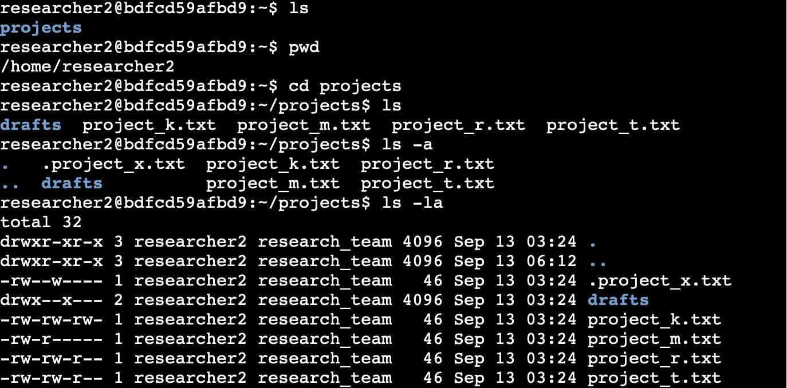
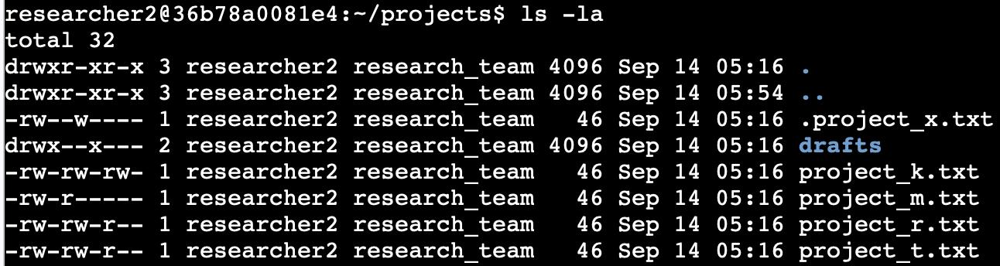
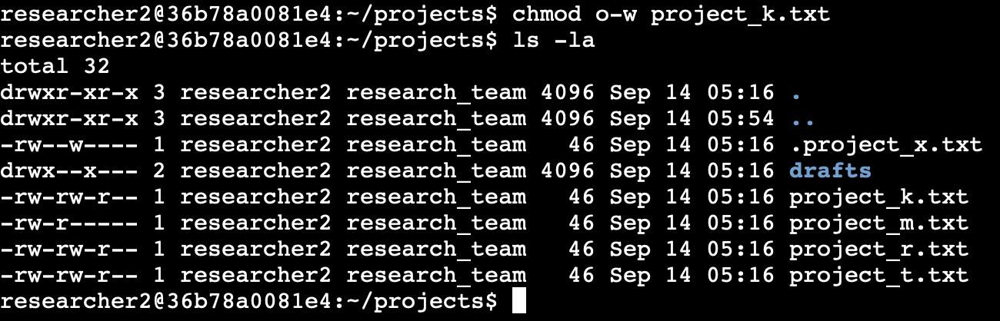
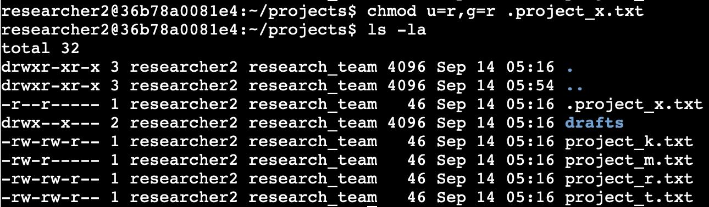
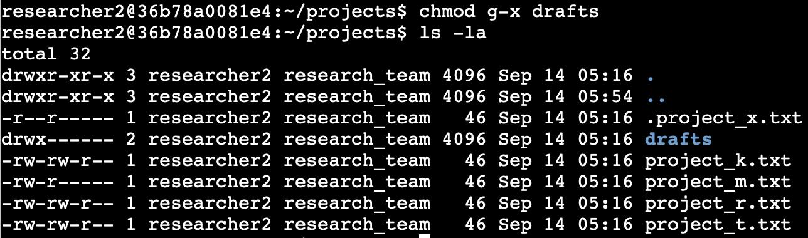

# File Permissions in Linux

## Overview

As a security professional working with a research team, I made sure users had the right permissions on the file system. I examined the permissions in a `projects` directory, compared them with the organization's rules, and used `chmod` to fix anything that did not match.

**Tools:** Linux command line (`pwd`, `cd`, `ls`, `chmod`)

**Skills demonstrated:** reading permission strings, changing permissions with `chmod`, and applying the principle of least privilege

## Requirements

- The organization does not allow others to have write access to any file.
- `.project_x.txt` is archived (which is why it is hidden). Nobody should have write access to it, but the user and group should be able to read it.
- Only the user `researcher2` should be able to access the `drafts` directory and its contents.

## Step 1: Check file and directory details

I started by checking my location with `pwd`, then moved into the right directory with `cd projects`. I listed the contents with `ls`, and used `ls -a` to check for hidden files. This showed one hidden file (`.project_x.txt`), four `.txt` files, and a `drafts` directory. Then I used `ls -la` to see the permissions of everything, including the hidden file.

```bash
pwd
cd projects
ls
ls -a
ls -la
```



## Understanding the permissions string

Linux shows permissions as a 10-character string. For example, `drwxr-xrw-` breaks down like this:

| Position | Characters | Meaning |
|---|---|---|
| 1 | `d` | File type: `d` is a directory, `-` is a regular file |
| 2-4 | `rwx` | Permissions for the **user** (owner) |
| 5-7 | `r-x` | Permissions for the **group** |
| 8-10 | `rw-` | Permissions for **others** |

In each set of three, the letters mean read (`r`), write (`w`), and execute (`x`). A hyphen (`-`) means that permission is missing.

| Permission | On a file | On a directory |
|---|---|---|
| Read (`r`) | View the contents | List the files and subdirectories |
| Write (`w`) | Modify the contents | Create new files in the directory |
| Execute (`x`) | Run it, if it is a program | Enter the directory and access its files |

## Changing permissions with `chmod`

`chmod` takes two arguments: how to change the permissions, and which file or directory to change. The letters `u`, `g`, and `o` stand for user, group, and others.

- `+` adds a permission, `-` removes one, and `=` sets the permissions exactly as specified.
- Separate multiple changes with commas and **no spaces**.

```bash
# Add all permissions for everyone on project_m.txt
chmod u+rwx,g+rwx,o+rwx project_m.txt

# Remove all permissions
chmod u-rwx,g-rwx,o-rwx project_m.txt

# Set exact permissions (user read/write, group read)
chmod u=rw,g=r project_m.txt
```

## Step 2: Find files that break the rules

These were the permissions before I made any changes:



| Item | Permissions | Problem |
|---|---|---|
| `project_k.txt` | `-rw-rw-rw-` | Others can write |
| `.project_x.txt` | `-rw--w----` | User and group can write, and the group cannot read it |
| `drafts` | `drwx--x---` | The group has execute access |

`project_m.txt`, `project_r.txt`, and `project_t.txt` already follow the rules.

## Step 3: Fix the permissions

### Remove write access for others on `project_k.txt`

```bash
chmod o-w project_k.txt
```

`project_k.txt` is now `-rw-rw-r--`.



### Make the hidden file read-only for the user and group

```bash
chmod u=r,g=r .project_x.txt
```

Hidden files start with a period, so the period must be included in the name. `.project_x.txt` is now `-r--r-----`: the user and group can read it, and nobody can write to it.



### Restrict the `drafts` directory to its owner

Only `researcher2` should be able to access `drafts`, but the group had execute permission, which lets them enter the directory. I removed it:

```bash
chmod g-x drafts
```

`drafts` is now `drwx------`, which gives only the owner access.



## Summary

I reviewed the permissions of every file and directory in the `projects` folder and changed the three that did not follow the organization's rules. This applies the principle of least privilege: each user gets only the access they need, which helps ensure that only authorized users can read or modify the files.
