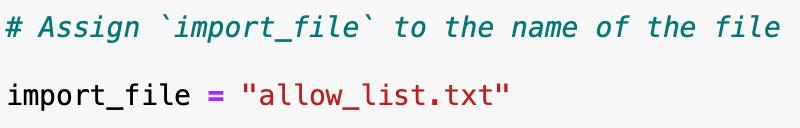
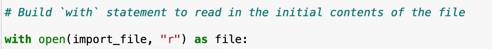
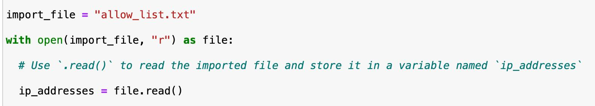
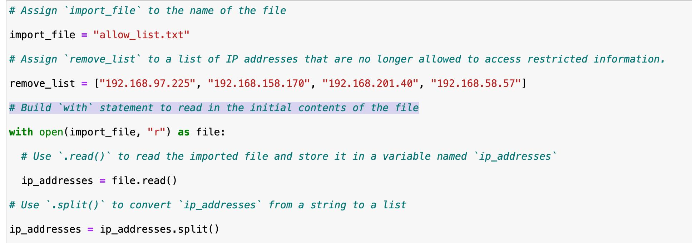
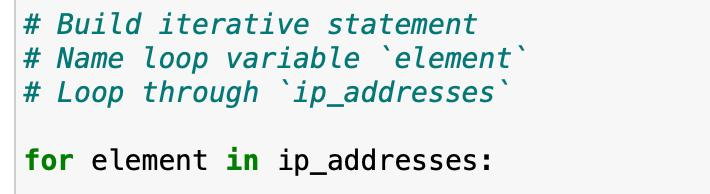
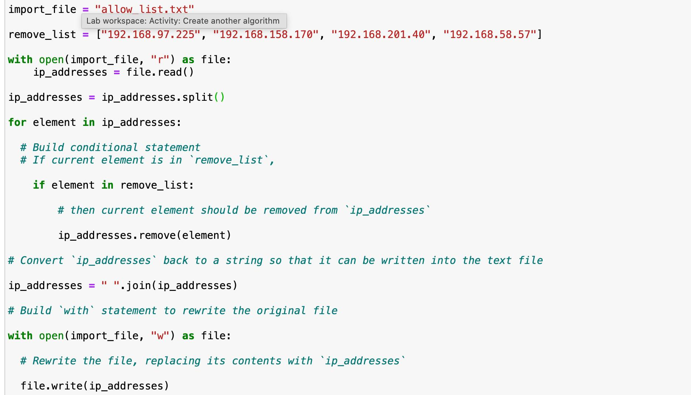

# Algorithm for File Updates in Python

## Overview

I work as a security professional at a health care company. Access to a restricted subnetwork is controlled by IP address: an **allow list** (`allow_list.txt`) holds the addresses that may sign in, and a **remove list** holds the addresses of employees who must no longer have access. I wrote a Python algorithm that checks the allow list for any address on the remove list and removes it from the file.

**Tools:** Python 3, Jupyter Notebook

**Skills demonstrated:** file handling, strings and lists, loops, conditionals

## Step 1: Open the file that contains the allow list

The text file is in the same folder as my notebook, so I did not need to give a file path. I stored the file name as a string in a variable named `import_file`:

```python
# Assign `import_file` to the name of the file
import_file = "allow_list.txt"
```



Then I opened the file with a `with` statement:

```python
# Build `with` statement to read in the initial contents of the file
with open(import_file, "r") as file:
```



- The `with` statement manages resources for me by closing the file automatically when the block ends.
- `open()` takes two arguments: the file to open (`import_file`) and the mode. `"r"` means read mode.
- `as file` stores the opened file in a variable named `file`.

## Step 2: Read the file contents

Because the file was opened in read mode, I can call `.read()` on `file` inside the `with` block. It converts the contents of the file into a single string, which I stored in `ip_addresses`.

```python
import_file = "allow_list.txt"

with open(import_file, "r") as file:
    # Use `.read()` to read the imported file and store it in a variable named `ip_addresses`
    ip_addresses = file.read()
```



## Step 3: Convert the string into a list

A string is immutable, which means it can't be changed once it exists. To remove items from the contents, I needed a list. I called `.split()` on `ip_addresses`, which splits the string on whitespace into a list of separate IP addresses, and stored the result back in `ip_addresses`.

```python
# Use `.split()` to convert `ip_addresses` from a string to a list
ip_addresses = ip_addresses.split()
```

The remove list is defined at the top of the code:

```python
remove_list = ["192.168.97.225", "192.168.158.170", "192.168.201.40", "192.168.58.57"]
```



## Step 4: Iterate through the list

I added a `for` loop to go through the IP addresses one at a time. A `for` loop repeats its block once for each element in a list.

```python
# Build iterative statement
# Name loop variable `element`
# Loop through `ip_addresses`
for element in ip_addresses:
```



## Step 5: Remove IP addresses that are on the remove list

Inside the loop, an `if` statement checks whether the current element is in `remove_list`. If it is, `.remove()` deletes it from `ip_addresses`.

```python
for element in ip_addresses:
    # If current element is in `remove_list`,
    if element in remove_list:
        # then current element should be removed from `ip_addresses`
        ip_addresses.remove(element)
```

## Step 6: Update the file with the revised list

To write the list back to the file, I first converted it into a string with `.join()`, which combines all the items of a list into one string, with a space between each. Then I used another `with` statement, this time in write mode (`"w"`), and called `.write()` to replace the file's contents.

```python
# Convert `ip_addresses` back to a string so that it can be written into the text file
ip_addresses = " ".join(ip_addresses)

# Build `with` statement to rewrite the original file
with open(import_file, "w") as file:
    # Rewrite the file, replacing its contents with `ip_addresses`
    file.write(ip_addresses)
```

Here is the complete notebook code:



## Improving the algorithm

My notebook version removes items from `ip_addresses` while looping over `ip_addresses`. Changing a list while looping over it can make Python skip items. For example, if two addresses in a row are both on the remove list, the second one can be missed. I wrote an improved version, [`update_allow_list.py`](update_allow_list.py), that:

- loops over the **remove list** and removes matches from the allow list, so the list being changed is never the list being looped over
- uses a `while` loop so duplicate entries of the same address are also removed
- puts the logic in a reusable function and handles a missing file

## Summary

I created an algorithm that removes IP addresses from an allow list. It reads the file into a string, converts the string into a list (because strings are immutable), and uses a `for` loop with a conditional statement to check each address against the remove list. Matching addresses are deleted with `.remove()`. Finally, `.join()` converts the list back into a string so `.write()` can replace the contents of the file with the updated list.
